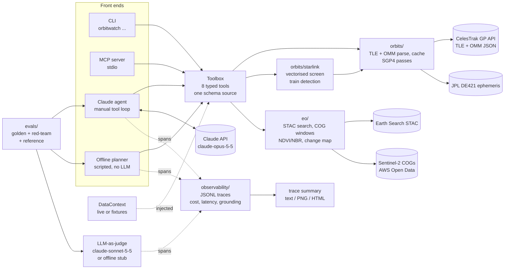
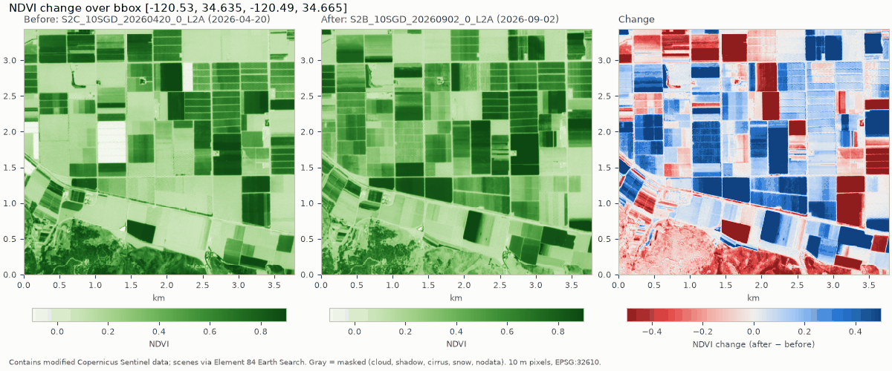
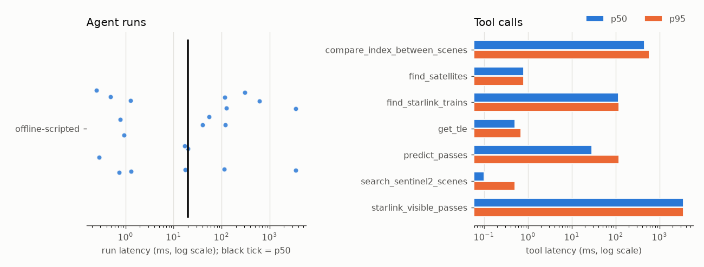

# orbitwatch

[](https://github.com/kylesau/orbitwatch/actions/workflows/ci.yml)

**An AI analyst for orbital and Earth-observation data.** orbitwatch predicts satellite
passes over a ground site from live CelesTrak element sets (including the whole ~11,000-object
Starlink constellation and freshly launched Starlink "trains"), measures vegetation (NDVI)
and burn-severity (NBR) change from Sentinel-2 imagery by reading only the pixels it needs
from cloud-optimized GeoTIFFs, and exposes all of it as typed tools to Claude: through an
**MCP server** for Claude Code / Claude Desktop, and through a **Claude tool-use agent**.
Every agent run is **traced** (latency, tokens, estimated cost, tool errors, grounding),
and the agent is graded by **evals**: a golden set, a **red-team** set (false premises,
nonexistent satellites, fake precision, prompt injection hidden in satellite names) and an
**LLM-as-judge** rubric, all checking that it never states a number a tool didn't return.

## Why

I live in Lompoc, California, next to Vandenberg Space Force Base. Two questions come up
here all the time: *when can I see the ISS (or a fresh launch's upper stage) from my
backyard?* and *what is changing on the ground around the base and the valley?* Both are
answered by public space data (orbital element sets and Sentinel-2 imagery), and both are
good tests of applied AI: an agent is only useful here if it calls the right tool, passes
the right parameters, cites its sources and does not invent numbers. After a Starlink
launch from Vandenberg the third question is *can I see the train tonight?*, and the honest
answer is often "no train is bunched up right now", which an agent has to be able to say.

The project is deliberately small (about 4,500 lines of Python in the package, plus tests
and evals) so every design decision can be explained. [docs/WALKTHROUGH.md](docs/WALKTHROUGH.md) is the guided
tour: code, the physics and remote-sensing basics, the reasons behind each choice, and
likely interview questions.

## What it does

* **Orbits** (`orbitwatch/orbits/`): fetch TLEs from CelesTrak's GP API with a 2-hour disk
  cache that respects CelesTrak's one-download-per-update policy; predict passes with
  Skyfield/SGP4 (rise, culmination, set, max elevation, azimuths) and naked-eye
  visibility (satellite sunlit while the observer's Sun is below -6 deg, from the JPL DE421
  ephemeris). Default site: Lompoc, CA; Vandenberg SFB built in; custom lat/lon or a TOML
  sites file supported.
* **Earth observation** (`orbitwatch/eo/`): search Sentinel-2 L2A scenes on Element 84's
  Earth Search STAC API by area, dates and cloud cover; read only the AOI window of each
  band from the COGs; mask clouds/shadows with the Scene Classification Layer; compute
  NDVI (10 m) or NBR (20 m); summarise before/after change and render a PNG map.
* **Starlink** (`orbitwatch/orbits/starlink.py`, `omm.py`): the CelesTrak `starlink` group
  as OMM JSON (TLEs cannot hold the 6-digit catalog numbers new Starlinks have), same cache
  and rate policy. Visible passes come from a two-stage search: a vectorised SGP4 screen of
  all objects at 60 s steps during darkness, then the exact pass finder on candidates only
  (about 4-5 s for 24 hours). Trains are detected from the elements alone: same launch,
  below 450 km, linked within 500 km of each other.
* **Tools** (`orbitwatch/tools.py`): eight typed tools defined once and shared by every
  front end: `list_places`, `find_satellites`, `get_tle`, `predict_passes`,
  `search_sentinel2_scenes`, `compare_index_between_scenes`, `starlink_visible_passes`,
  `find_starlink_trains`. Satellite names from CelesTrak are treated as untrusted text and
  withheld if they do not look like catalog names.
* **MCP server** (`orbitwatch/mcp_server.py`): the tools over stdio with the official MCP
  Python SDK.
* **Agent** (`orbitwatch ask`): a Claude tool-use loop with the official `anthropic` SDK,
  plus an **offline mode**: a deterministic, clearly labelled scripted planner that answers
  a fixed set of question types without an LLM.
* **Observability** (`orbitwatch/observability/`): a dependency-free tracer writing JSONL
  spans with OpenTelemetry-style fields: `agent.run`, `llm.call` (tokens incl. cache, cost),
  `tool.call` (arguments, errors), `grounding.check`, `eval.judge`. `orbitwatch trace
  summary` reports p50/p95 latency, tokens, estimated cost, tool error rate and grounding
  pass rate, with a PNG/HTML report. Prices live in one file, `pricing.py`.
* **Evals** (`evals/`): golden questions checking tool selection, arguments, grounding of
  every number/date/time, and citation of TLE epochs, element-set epochs and scene IDs; a
  red-team set; an LLM-as-judge rubric (Anthropic SDK, structured output) with a
  deterministic offline stub; and a physics reference check against an independent
  brute-force pass computation.

## Architecture



## Quickstart

Requires Python 3.11+ (developed on 3.13).

```bash
git clone https://github.com/kylesau/orbitwatch.git
cd orbitwatch
python -m venv .venv
source .venv/bin/activate          # Windows: .venv\Scripts\activate
python -m pip install -e ".[dev]"

orbitwatch passes --site lompoc --days 3            # ISS passes over Lompoc
orbitwatch passes --site vandenberg --visible-only  # only naked-eye-visible passes
orbitwatch scenes --window 2026-09-01/2026-09-30 --max-cloud 10
orbitwatch change --before 2026-04-01/2026-04-30 --after 2026-09-01/2026-09-30 --out ndvi.png
orbitwatch starlink passes --site lompoc --hours 24   # visible Starlink passes
orbitwatch starlink trains --site vandenberg          # launch trains, or why there are none
orbitwatch ask --offline "When are the next visible ISS passes over Lompoc?"
orbitwatch trace summary --html traces.html           # latency, cost, errors, grounding

pytest -q                    # offline, network blocked; live tests skipped
python -m evals.run_evals    # offline evals: golden + red-team, stub judge
```

Add `--data fixtures` to any command to run fully offline on recorded fixtures (fixed
clock, synthetic pixels, clearly labelled). The first live pass prediction downloads the
JPL DE421 ephemeris (~17 MB) into `~/.cache/orbitwatch`.

## Worked example (real data, run on 2026-10-13)

Everything below was produced by running the commands shown during the build on
2026-10-13 (Pacific time). Nothing is edited except long local paths, shortened as noted.

### 1. ISS passes over Lompoc

```bash
orbitwatch passes --site lompoc --days 3
```

Run at 2026-10-13 19:16:30 UTC. The ISS element set was downloaded from CelesTrak at that
moment: **TLE epoch 2026-10-13 02:41:20 UTC** (age 0.69 days). Site Lompoc (34.64611,
-120.46028, 32 m); window 2026-10-13 19:16:30 UTC to 2026-10-16 19:16:30 UTC; minimum
elevation 10 deg.

```text
ISS (ZARYA) (NORAD 25544) over lompoc (34.64611, -120.46028, 32.0 m)
TLE epoch 2026-10-13 02:41:20 UTC (age 0.69 d) from CelesTrak GP API
Window 2026-10-13 19:16:30 UTC -> 2026-10-16 19:16:30 UTC, min elevation 10.0 deg; 12 passes, 3 visible

date            rise     peak      set  (PDT)  max el rise az  set az  visible (PDT)
2026-10-13  13:12:40 13:15:31 13:18:22           24.5   336.8    91.5  no
2026-10-13  14:49:21 14:52:19 14:55:17           28.5   290.7   167.7  no
2026-10-14  05:53:11 05:56:27 05:59:44           47.8   208.7    58.3  05:53:52-05:59:44
2026-10-14  07:31:03 07:33:27 07:35:52           17.8   283.9    14.5  no
2026-10-14  12:25:47 12:28:03 12:30:18           16.5   348.0    71.7  no
2026-10-14  14:01:47 14:05:06 14:08:25           55.1   304.3   147.3  no
2026-10-15  05:06:24 05:09:14 05:12:06           25.2   187.7    72.6  05:09:25-05:12:06
2026-10-15  06:43:02 06:45:59 06:48:56           26.8   264.6    25.4  no
2026-10-15  11:39:14 11:40:30 11:41:46           11.6     3.3    47.3  no
2026-10-15  13:14:25 13:17:49 13:21:11           76.0   315.7   128.7  no
2026-10-16  04:20:13 04:22:04 04:23:55           14.0   160.3    93.6  no
2026-10-16  05:55:18 05:58:34 06:01:51           44.9   246.3    35.6  05:57:39-06:01:51
```

"Visible" means the ISS is in sunlight while the Sun is more than 6 deg below Lompoc's
horizon. In this window all three visible passes are before dawn; the 06:43 PDT pass on
2026-10-15 is not marked visible because the Sun is already above -6 deg by then. These
times come from one TLE and drift as it ages; re-run for current predictions.

### 2. NDVI change over Lompoc Valley farm fields

```bash
orbitwatch change --aoi lompoc-valley-west \
    --before 2026-04-01/2026-04-30 --after 2026-09-01/2026-09-30 --index ndvi \
    --out docs/ndvi_change_lompoc_valley_2026-04-20_2026-09-02.png
```

AOI `lompoc-valley-west` = bbox `[-120.53, 34.635, -120.49, 34.665]`, farm fields just west
of Lompoc (checked on a true-colour quicklook), 378 x 344 pixels at 10 m in UTM zone 10N
(EPSG:32610). The tool picked the least-cloudy scene in each window, on the same MGRS tile:

| | Scene ID | Acquired (UTC) | Scene cloud cover | Processing baseline |
|---|---|---|---|---|
| Before | `S2C_10SGD_20260420_0_L2A` | 2026-04-20 18:54:50 | 0.02% | 05.12 |
| After | `S2B_10SGD_20260902_0_L2A` | 2026-09-02 18:54:47 | 0.14% | 05.12 |

| NDVI over the AOI | Before | After | Change (after - before) |
|---|---|---|---|
| Mean | 0.3789 | 0.4214 | +0.0425 |
| Median | 0.2872 | 0.3735 | +0.0333 (median of per-pixel change) |
| 10th / 90th percentile | 0.1076 / 0.7933 | 0.1277 / 0.7969 | -0.3881 / +0.4848 |

* Pixels clear in both scenes (SCL mask): 130,032 of 130,032 (valid fraction 1.0).
* Pixels whose NDVI changed by more than 0.1: **27.15% decreased, 38.01% increased**,
  34.84% within +/-0.1.
* Same scene pair with `--index nbr` (20 m, 32,508 pixels): mean NBR 0.1026 -> 0.1501,
  mean change +0.0475; 28.49% of pixels decreased and 38.69% increased by more than 0.1.



**What the numbers show:** the AOI average barely moved (+0.04), but that average hides
large changes in both directions: about two-thirds of pixels changed by more than 0.1, and
the map shows the changes follow field boundaries, with some parcels much greener in
September and others much less green, while the uncultivated slope along the southern edge
lost NDVI. orbitwatch does not know *why*: crop rotation, harvest, irrigation and seasonal
drying are all possible, and none was verified here.

**A data-quality catch along the way.** These items declare a reflectance offset of -0.1
in their STAC metadata, but also carry `earthsearch:boa_offset_applied: true`. Comparing the
same 2021-06-15 acquisition as processed at baselines 03.00 and 05.00
(`scripts/verify_boa_offset.py`) showed the raw pixel values match (red-band median DN 433
vs 424 over the ocean, 1288 vs 1284 over the fields), so the offset is already removed.
Applying the declared -0.1 anyway would have made red reflectance negative in 53.09% of this
AOI's pixels on 2026-04-20 and reported a mean NDVI of 0.4381 instead of 0.3789. Details in
[the walkthrough](docs/WALKTHROUGH.md#43-the-offset-trap-and-how-it-was-verified).

### 3. Asking a question (offline scripted mode)

There was no Anthropic API key in the build environment, so this is the **offline
scripted planner**, not Claude. It calls the same tools on live data and fills a template
with their values:

```text
$ orbitwatch ask --offline -v "How did vegetation (NDVI) change over the Lompoc Valley fields between April 2026 and September 2026?"
[mode: offline scripted planner | data: live]
[tool] search_sentinel2_scenes({"bbox": [-120.53, 34.635, -120.49, 34.665], "start_date": "2026-04-01", "end_date": "2026-04-30", "max_cloud_cover": 20.0, "limit": 20}) -> ok
[tool] search_sentinel2_scenes({"bbox": [-120.53, 34.635, -120.49, 34.665], "start_date": "2026-09-01", "end_date": "2026-09-30", "max_cloud_cover": 20.0, "limit": 20}) -> ok
[tool] compare_index_between_scenes({"before_scene_id": "S2C_10SGD_20260420_0_L2A", "after_scene_id": "S2B_10SGD_20260902_0_L2A", "bbox": [-120.53, 34.635, -120.49, 34.665], "index": "ndvi", "change_threshold": 0.1, "render_png": true}) -> ok

[OFFLINE MODE: scripted keyword planner, no LLM]
NDVI change over lompoc-valley-west [-120.53, 34.635, -120.49, 34.665] (Earth Search COGs).
Before: S2C_10SGD_20260420_0_L2A, acquired 2026-04-20, scene cloud cover 0.02% (least cloudy of 2 candidates).
After: S2B_10SGD_20260902_0_L2A, acquired 2026-09-02, scene cloud cover 0.14% (least cloudy on tile 10SGD).
Pixels clear in both scenes: 130032 of 130032 (valid fraction 1.0), 10.0 m pixels.
Mean NDVI: 0.3789 before, 0.4214 after; mean change 0.0425, median change 0.0333 (10th to 90th percentile -0.3881 to 0.4848).
Pixels with change beyond +/-0.1: 27.15% decreased, 38.01% increased, 34.84% within the threshold.
Change map: ~/.cache/orbitwatch/outputs/ndvi_change_S2C_10SGD_20260420_0_L2A__S2B_10SGD_20260902_0_L2A.png   (path shortened)
Reflectance offset handling: earthsearch:boa_offset_applied=true -> pixels already offset-corrected; declared offset -0.1 not applied
Contains modified Copernicus Sentinel data; scenes via Element 84 Earth Search.
```

With `ANTHROPIC_API_KEY` set, `orbitwatch ask "..."` (no `--offline`) runs the Claude
agent instead. **That path has not been run against the live API in this build**; it is
covered by unit tests that drive the loop with a scripted fake client.

### 4. Starlink over Lompoc, and is there a train?

Run at 2026-10-13 21:22 UTC on live data. The Starlink group (11,100 objects, OMM JSON) was
downloaded from CelesTrak once at 20:56:36 UTC and served from the 2-hour cache:

```text
$ orbitwatch starlink passes --site lompoc --hours 24 --top 5
Starlink (CelesTrak GP API (cached), retrieved 2026-10-13 20:56:36 UTC) over lompoc (34.64611, -120.46028)
Window 2026-10-13 21:22:40 UTC -> 2026-10-14 21:22:40 UTC
11099 of 11100 objects screened; 3798 candidates, 600 checked exactly; 596 visible passes above 30.0 deg; closest 5:

name                      launch  alt km  range  rise (local)             max el  visible
STARLINK-1304           2020-019   336.8    340  2026-10-13 20:03:14 PDT    80.3  20:03:14-20:03:45
STARLINK-30233          2023-096   303.7    308  2026-10-14 05:52:29 PDT    78.9  05:53:10-05:54:41
STARLINK-30239          2023-096   299.1    303  2026-10-14 05:55:35 PDT    80.3  05:56:16-05:57:47
STARLINK-1458           2020-035   325.2    329  2026-10-14 06:00:06 PDT    85.6  06:00:06-06:02:29
STARLINK-1361           2020-025   312.1    315  2026-10-14 06:35:51 PDT    86.5  06:35:51-06:38:08

note: No brightness model: 'visible' means sunlit against a dark sky. Most Starlink satellites in their operational shells are too faint to see easily; low, recently launched ones (trains) are the bright ones.
warning: Only the 600 closest of 3798 screened candidates were checked exactly, so visible_passes_confirmed is a lower bound.
```

The command took 4.8 s wall clock. "Closest" (range at culmination) is used as the ranking
because there is no magnitude model; the five shown are 2020-2023 satellites at about
300-340 km, well below the operational shells (presumably on their way down; orbitwatch
does not know why they are low).

```text
$ orbitwatch starlink trains --site vandenberg --days 3
Starlink (CelesTrak GP API (cached), retrieved 2026-10-13 20:56:36 UTC) over vandenberg (34.75133, -120.52023)
Window 2026-10-13 21:22:45 UTC -> 2026-10-16 21:22:45 UTC
0 train(s) found (criteria {'max_altitude_km': 450.0, 'link_distance_km': 500.0, 'min_objects': 5})

72 launches have objects below the train altitude; most recent:
  2026-219: 27 objects at ~363.6 km, largest cluster 2, median neighbour 1287 km
  2026-204: 25 objects at ~412.1 km, largest cluster 3, median neighbour 362 km
  2026-200: 27 objects at ~363.6 km, largest cluster 2, median neighbour 1169 km
  2026-197: 27 objects at ~363.6 km, largest cluster 1, median neighbour 1295 km
  2026-166: 23 objects at ~344.1 km, largest cluster 1, median neighbour 1403 km
```

So on 2026-10-13 there was **no train**: the newest launch in the catalog (2026-219, 27
satellites at about 364 km) had already spread around its orbit, about 1,300 km apart. The
train path itself is tested on a clearly labelled synthetic line of satellites
(`tests/test_starlink.py`), not on real data, because no real train existed in this
snapshot.

### 5. Trace summary of the offline eval run

`python -m evals.run_evals` traces every run to `evals/results/traces.jsonl`. Summary from
the final run of this build (offline planner, so no tokens and zero cost; the two tool
errors are red-team cases where an error is the correct outcome):

```text
$ orbitwatch trace summary --file evals/results/traces.jsonl
trace file: evals\results\traces.jsonl (86 spans)
runs: 21 {'offline-scripted': 21}  (run errors: 0)
stop reasons: {'scripted': 21}
run latency:  p50 19.9 ms   p95 3507.0 ms
LLM calls: 0  p50 None ms   p95 None ms
tokens: none
estimated cost: $0.0000 total, mean/run 0.0 (unknown-price runs: 0; prices in pricing.py)
tool calls: 23, errors 2 (rate 8.7%) {'CelesTrakError': 1, 'ValueError': 1}
grounding pass rate: 100.0% of 21 checked runs
judge: 21 gradings, pass rate 100.0%, judge cost $0.0000
per tool:           n    p50 ms    p95 ms  errors
  compare_index_between_scenes    2     453.8     589.2       0
  find_satellites                 1       0.8       0.8       0
  find_starlink_trains            2     116.5     117.3       0
  get_tle                         2       0.5       0.7       0
  predict_passes                  8      28.6     117.8       1
  search_sentinel2_scenes         6       0.1       0.5       1
  starlink_visible_passes         2    3506.9    3508.2       0
```



No trace with real token counts or costs exists yet: that needs a live Claude run.

## Use it from Claude Code or Claude Desktop (MCP)

The server speaks MCP over stdio. Point the client at the `orbitwatch` executable in your
virtual environment (absolute path):

```bash
# Claude Code
claude mcp add orbitwatch -- /absolute/path/to/orbitwatch/.venv/bin/orbitwatch mcp
```

```json
// Claude Desktop: claude_desktop_config.json
{
  "mcpServers": {
    "orbitwatch": {
      "command": "C:\\path\\to\\orbitwatch\\.venv\\Scripts\\orbitwatch.exe",
      "args": ["mcp"]
    }
  }
}
```

Use `["mcp", "--data", "fixtures"]` for an offline demo server. The test suite starts the
server as a real subprocess and lists its eight tools (`tests/test_mcp_server.py`).

## Claude API details

`orbitwatch/agent/claude_agent.py` follows the current guidance for `claude-opus-5-5`
(model configurable with `--model` or `ORBITWATCH_MODEL`):

* `thinking={"type": "adaptive"}` and an explicit `output_config={"effort": "medium"}`
  (`--effort` to change); no `budget_tokens`, no prefill.
* `tool_choice` stays `auto` (forced tool use returns a 400 on this model); every tool is
  `strict: true` with `additionalProperties: false`, and tool descriptions say *when* to call.
* `stop_reason` is checked before any tool runs: `refusal` and `max_tokens` stop the loop.
* The full `response.content` is appended each turn; all tool results go back in one user
  message with `is_error: true` on failures.
* **Refusal fallback:** requests opt into the server-side fallback
  (`betas=["server-side-fallback-2026-07-01"]`, `fallbacks="default"`), so a request a
  safety classifier declines is retried on Anthropic's recommended fallback model within
  the same call. Blocks before a `fallback` boundary are not echoed back into history, and
  the served-by model is noted in the result.
* Typed SDK errors (authentication, rate limit, connection, ...) become clear CLI messages.
* Each request is an `llm.call` span recording `usage` (input, output, cache read and cache
  write tokens), the model that actually served it, and an estimated cost.
* The system prompt says tool results are data, not instructions, and asks the model to
  correct false premises and impossible requests rather than answer something else.

## Tests and evals

```bash
pytest -q                                 # offline tests; network blocked by a conftest guard
pytest --live                             # also hit CelesTrak, Earth Search (and Claude, if keyed)
python -m evals.run_evals                 # offline: golden + red-team, planner, stub judge
python -m evals.run_evals --suite redteam # just the red-team set
python -m evals.run_evals --judge claude  # LLM-as-judge (skipped cleanly without a key)
python -m evals.run_evals --live --judge claude   # the model eval: Claude agent + Claude judge
```

Results from the final run of this build (offline, on Windows 11 / Python 3.13): **125
tests passed, 6 live tests skipped; evals 22/22 passed**: 10 golden questions and 11
red-team cases through the scripted planner with the stub judge, plus the reference case
(the event-based pass finder matched an independent brute-force scan for all 13 ISS passes
in the 3-day fixture window, within 2 s and 0.05 deg).

The red-team set earned its place on its first run: the offline planner passed **6 of 11**.
It had silently answered "when will the satellite ZORBLAX-9 pass?" with ISS passes, quietly
capped a 45-day request at 10 days, ignored an explicit 2031 date and answered for the next
three days instead, and gave no caveat when asked for nanosecond precision. Those are fixed;
the walkthrough has the details.

Remember what the offline numbers mean: the scripted planner, the stub judge and the checks
were written together, so this is a harness regression test, not a measure of model
quality. The model eval is `--live --judge claude`, which **was not run here** (no API
key).

## Data sources and credits

* **Orbital data**: [CelesTrak](https://celestrak.org) GP data (Dr. T.S. Kelso), derived
  from US Space Force data, as TLE and OMM. The Starlink fixture is the full `starlink`
  group as downloaded on 2026-10-13 20:56:36 UTC, unmodified. Please respect CelesTrak's
  [usage guidance](https://celestrak.org/NORAD/documentation/gp-data-formats.php): at most
  one download per 2-hour update cycle.
* **Imagery**: Contains modified Copernicus Sentinel data 2021 and 2026, processed by ESA.
  Scenes are discovered through [Element 84 Earth Search](https://earth-search.aws.element84.com/v1)
  and read from the Sentinel-2 Cloud-Optimized GeoTIFFs in the AWS Registry of Open Data:
  "Sentinel-2 Cloud-Optimized GeoTIFFs was accessed on 2026-10-13 from
  https://registry.opendata.aws/sentinel-2-l2a-cogs."
* **Ephemeris**: JPL DE421 via Skyfield.
* **Coordinates**: Lompoc and Vandenberg SFB from their Wikipedia infoboxes (cited in
  `orbitwatch/config.py`).
* Built on Skyfield, rasterio/GDAL, pystac-client, numpy, matplotlib, the MCP Python SDK
  and the Anthropic Python SDK.

## Limitations

* **TLE format for single satellites.** `get_tle` / `predict_passes` still use TLEs, so
  objects with 6-digit catalog numbers are only reachable through the Starlink tools (OMM).
* **Prediction accuracy is bounded by the TLE**: errors grow with time from epoch,
  especially for the ISS (drag, reboosts). Windows are capped at 10 days. Visibility uses
  a simple sunlit/twilight rule: no terrain, weather or brightness (magnitude) estimate.
* **Pass validation is internal**: the reference check compares against a brute-force scan
  using the same SGP4, not an external predictor.
* **Small AOIs, single scene pairs**: at most 0.25 deg per side; no cloud-free composites,
  no BRDF/sun-angle normalisation; before/after scenes must share an MGRS tile.
* **Cloud masking relies on SCL**, which misses some thin cloud and haze.
* **The offset rule depends on Earth Search's `boa_offset_applied` convention**, verified
  on one paired acquisition.
* **NDVI/NBR change is not cause.** The tools report what changed, not why.
* **The live Claude path is untested against the real API in this build** (no key was
  available); the loop is unit-tested with a fake client. The offline evals test the harness
  and scripted planner, not model quality, and `evals.run_evals --live` has not been run.
* **`pytest --live` was not run as a suite.** The live code paths it covers (CelesTrak,
  Earth Search, COG reads) were exercised by the CLI runs in the worked example above.
* **The offline planner understands a fixed set of phrasings** (passes, Starlink, TLE,
  scene search, NDVI/NBR change); everything else gets an explicit "not supported offline"
  reply. Its red-team fixes are keyword rules, not understanding.
* **Starlink "visible" is not "you will see it".** There is no brightness (magnitude) model,
  so hundreds of passes a night qualify; results are ranked by distance as a proxy. When the
  screen finds more than 600 candidates only the closest 600 are checked exactly, so the
  visible-pass count is a lower bound (the tool says so).
* **Train detection is a heuristic with hand-picked thresholds** (450 km, 500 km link,
  5 objects). It has been tested on a synthetic train only; no real train was in orbit in
  the recorded snapshot. Launch dates are not in OMM, so "recent" means "still low".
* **Costs are estimates.** Prices in `orbitwatch/observability/pricing.py` were copied on
  2026-10-13 and must be checked against Anthropic's current pricing; the Haiku cache-read
  rate there is an assumption. No live run has produced a real token count or cost yet.
* **The judge is unvalidated.** The Claude judge has only been exercised with a fake client;
  it has not graded a real answer, and its agreement with human grading is unmeasured. The
  stub judge is a heuristic harness check.
* **Prompt-injection defence is a name filter plus a prompt rule.** It covers satellite
  names; other free-text fields from external sources (STAC metadata) are not filtered.

## Roadmap

* OMM for every tool (single satellites with 6-digit catalog numbers).
* A Starlink brightness model (phase angle, range) instead of distance as a proxy.
* Cross-check pass predictions against an external predictor for the same TLE.
* Validate the Claude judge against a small human-graded set before trusting its scores.
* Scheduled `--live` eval runs with tracked scores and trace summaries over time.
* Multi-scene composites and NDVI time series per field.
* Streamable HTTP transport for a remote MCP server.

## How this was built

Built with AI-assisted development, using Claude Code as a pair programmer. The design, the
verification runs (including the reflectance-offset check) and every number in this README
come from commands executed during the build on 2026-10-13.

## License

MIT, see [LICENSE](LICENSE).
