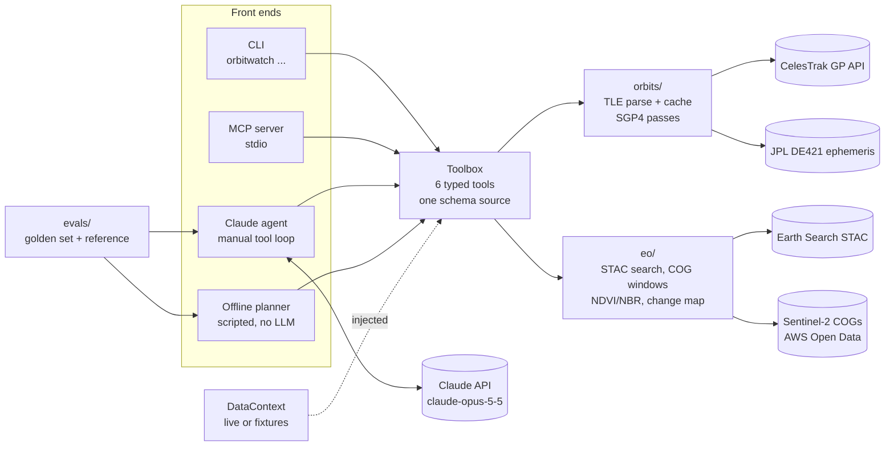

# orbitwatch

[](https://github.com/kylesau/orbitwatch/actions/workflows/ci.yml)

**An AI analyst for orbital and Earth-observation data.** orbitwatch predicts satellite
passes over a ground site from live CelesTrak element sets, measures vegetation (NDVI) and
burn-severity (NBR) change from Sentinel-2 imagery by reading only the pixels it needs from
cloud-optimized GeoTIFFs, and exposes both as typed tools to Claude: through an **MCP
server** for Claude Code / Claude Desktop, and through a **Claude tool-use agent** with
evals that check it never states a number a tool didn't return.

## Why

I live in Lompoc, California, next to Vandenberg Space Force Base. Two questions come up
here all the time: *when can I see the ISS (or a fresh launch's upper stage) from my
backyard?* and *what is changing on the ground around the base and the valley?* Both are
answered by public space data (orbital element sets and Sentinel-2 imagery), and both are
good tests of applied AI: an agent is only useful here if it calls the right tool, passes
the right parameters, cites its sources and does not invent numbers.

The project is deliberately small (about 2,300 lines of Python in the package, plus tests
and evals) so every design decision can be explained. [docs/WALKTHROUGH.md](docs/WALKTHROUGH.md) is the guided
tour: code, the physics and remote-sensing basics, the reasons behind each choice, and
likely interview questions.

## What it does

* **Orbits** (`orbitwatch/orbits/`): fetch TLEs from CelesTrak's GP API with a 2-hour disk
  cache that respects CelesTrak's one-download-per-update policy; predict passes with
  Skyfield/SGP4 (rise, culmination, set, max elevation, azimuths) and naked-eye
  visibility (satellite sunlit while the observer's Sun is below -6 deg, from the JPL DE421
  ephemeris). Default site: Lompoc, CA; Vandenberg SFB built in; custom lat/lon or a TOML
  sites file supported.
* **Earth observation** (`orbitwatch/eo/`): search Sentinel-2 L2A scenes on Element 84's
  Earth Search STAC API by area, dates and cloud cover; read only the AOI window of each
  band from the COGs; mask clouds/shadows with the Scene Classification Layer; compute
  NDVI (10 m) or NBR (20 m); summarise before/after change and render a PNG map.
* **Tools** (`orbitwatch/tools.py`): six typed tools defined once and shared by every
  front end: `list_places`, `find_satellites`, `get_tle`, `predict_passes`,
  `search_sentinel2_scenes`, `compare_index_between_scenes`.
* **MCP server** (`orbitwatch/mcp_server.py`): the tools over stdio with the official MCP
  Python SDK.
* **Agent** (`orbitwatch ask`): a Claude tool-use loop with the official `anthropic` SDK,
  plus an **offline mode**: a deterministic, clearly labelled scripted planner that answers
  a fixed set of question types without an LLM.
* **Evals** (`evals/`): golden questions checking tool selection, arguments, grounding of
  every number/date/time, and citation of TLE epochs and scene IDs; plus a physics
  reference check against an independent brute-force pass computation.

## Architecture



## Quickstart

Requires Python 3.11+ (developed on 3.13).

```bash
git clone https://github.com/kylesau/orbitwatch.git
cd orbitwatch
python -m venv .venv
source .venv/bin/activate          # Windows: .venv\Scripts\activate
python -m pip install -e ".[dev]"

orbitwatch passes --site lompoc --days 3            # ISS passes over Lompoc
orbitwatch passes --site vandenberg --visible-only  # only naked-eye-visible passes
orbitwatch scenes --window 2026-09-01/2026-09-30 --max-cloud 10
orbitwatch change --before 2026-04-01/2026-04-30 --after 2026-09-01/2026-09-30 --out ndvi.png
orbitwatch ask --offline "When are the next visible ISS passes over Lompoc?"

pytest -q                    # offline, network blocked; live tests skipped
python -m evals.run_evals    # offline evals
```

Add `--data fixtures` to any command to run fully offline on recorded fixtures (fixed
clock, synthetic pixels, clearly labelled). The first live pass prediction downloads the
JPL DE421 ephemeris (~17 MB) into `~/.cache/orbitwatch`.

## Worked example (real data, run on 2026-10-13)

Everything below was produced by running the commands shown during the build on
2026-10-13 (Pacific time). Nothing is edited except long local paths, shortened as noted.

### 1. ISS passes over Lompoc

```bash
orbitwatch passes --site lompoc --days 3
```

Run at 2026-10-13 19:16:30 UTC. The ISS element set was downloaded from CelesTrak at that
moment: **TLE epoch 2026-10-13 02:41:20 UTC** (age 0.69 days). Site Lompoc (34.64611,
-120.46028, 32 m); window 2026-10-13 19:16:30 UTC to 2026-10-16 19:16:30 UTC; minimum
elevation 10 deg.

```text
ISS (ZARYA) (NORAD 25544) over lompoc (34.64611, -120.46028, 32.0 m)
TLE epoch 2026-10-13 02:41:20 UTC (age 0.69 d) from CelesTrak GP API
Window 2026-10-13 19:16:30 UTC -> 2026-10-16 19:16:30 UTC, min elevation 10.0 deg; 12 passes, 3 visible

date            rise     peak      set  (PDT)  max el rise az  set az  visible (PDT)
2026-10-13  13:12:40 13:15:31 13:18:22           24.5   336.8    91.5  no
2026-10-13  14:49:21 14:52:19 14:55:17           28.5   290.7   167.7  no
2026-10-14  05:53:11 05:56:27 05:59:44           47.8   208.7    58.3  05:53:52-05:59:44
2026-10-14  07:31:03 07:33:27 07:35:52           17.8   283.9    14.5  no
2026-10-14  12:25:47 12:28:03 12:30:18           16.5   348.0    71.7  no
2026-10-14  14:01:47 14:05:06 14:08:25           55.1   304.3   147.3  no
2026-10-15  05:06:24 05:09:14 05:12:06           25.2   187.7    72.6  05:09:25-05:12:06
2026-10-15  06:43:02 06:45:59 06:48:56           26.8   264.6    25.4  no
2026-10-15  11:39:14 11:40:30 11:41:46           11.6     3.3    47.3  no
2026-10-15  13:14:25 13:17:49 13:21:11           76.0   315.7   128.7  no
2026-10-16  04:20:13 04:22:04 04:23:55           14.0   160.3    93.6  no
2026-10-16  05:55:18 05:58:34 06:01:51           44.9   246.3    35.6  05:57:39-06:01:51
```

"Visible" means the ISS is in sunlight while the Sun is more than 6 deg below Lompoc's
horizon. In this window all three visible passes are before dawn; the 06:43 PDT pass on
2026-10-15 is not marked visible because the Sun is already above -6 deg by then. These
times come from one TLE and drift as it ages; re-run for current predictions.

### 2. NDVI change over Lompoc Valley farm fields

```bash
orbitwatch change --aoi lompoc-valley-west \
    --before 2026-04-01/2026-04-30 --after 2026-09-01/2026-09-30 --index ndvi \
    --out docs/ndvi_change_lompoc_valley_2026-04-20_2026-09-02.png
```

AOI `lompoc-valley-west` = bbox `[-120.53, 34.635, -120.49, 34.665]`, farm fields just west
of Lompoc (checked on a true-colour quicklook), 378 x 344 pixels at 10 m in UTM zone 10N
(EPSG:32610). The tool picked the least-cloudy scene in each window, on the same MGRS tile:

| | Scene ID | Acquired (UTC) | Scene cloud cover | Processing baseline |
|---|---|---|---|---|
| Before | `S2C_10SGD_20260420_0_L2A` | 2026-04-20 18:54:50 | 0.02% | 05.12 |
| After | `S2B_10SGD_20260902_0_L2A` | 2026-09-02 18:54:47 | 0.14% | 05.12 |

| NDVI over the AOI | Before | After | Change (after - before) |
|---|---|---|---|
| Mean | 0.3789 | 0.4214 | +0.0425 |
| Median | 0.2872 | 0.3735 | +0.0333 (median of per-pixel change) |
| 10th / 90th percentile | 0.1076 / 0.7933 | 0.1277 / 0.7969 | -0.3881 / +0.4848 |

* Pixels clear in both scenes (SCL mask): 130,032 of 130,032 (valid fraction 1.0).
* Pixels whose NDVI changed by more than 0.1: **27.15% decreased, 38.01% increased**,
  34.84% within +/-0.1.
* Same scene pair with `--index nbr` (20 m, 32,508 pixels): mean NBR 0.1026 -> 0.1501,
  mean change +0.0475; 28.49% of pixels decreased and 38.69% increased by more than 0.1.


**What the numbers show:** the AOI average barely moved (+0.04), but that average hides
large changes in both directions: about two-thirds of pixels changed by more than 0.1, and
the map shows the changes follow field boundaries, with some parcels much greener in
September and others much less green, while the uncultivated slope along the southern edge
lost NDVI. orbitwatch does not know *why*: crop rotation, harvest, irrigation and seasonal
drying are all possible, and none was verified here.

**A data-quality catch along the way.** These items declare a reflectance offset of -0.1
in their STAC metadata, but also carry `earthsearch:boa_offset_applied: true`. Comparing the
same 2021-06-15 acquisition as processed at baselines 03.00 and 05.00
(`scripts/verify_boa_offset.py`) showed the raw pixel values match (red-band median DN 433
vs 424 over the ocean, 1288 vs 1284 over the fields), so the offset is already removed.
Applying the declared -0.1 anyway would have made red reflectance negative in 53.09% of this
AOI's pixels on 2026-04-20 and reported a mean NDVI of 0.4381 instead of 0.3789. Details in
[the walkthrough](docs/WALKTHROUGH.md#43-the-offset-trap-and-how-it-was-verified).

### 3. Asking a question (offline scripted mode)

There was no Anthropic API key in the build environment, so this is the **offline
scripted planner**, not Claude. It calls the same tools on live data and fills a template
with their values:

```text
$ orbitwatch ask --offline -v "How did vegetation (NDVI) change over the Lompoc Valley fields between April 2026 and September 2026?"
[mode: offline scripted planner | data: live]
[tool] search_sentinel2_scenes({"bbox": [-120.53, 34.635, -120.49, 34.665], "start_date": "2026-04-01", "end_date": "2026-04-30", "max_cloud_cover": 20.0, "limit": 20}) -> ok
[tool] search_sentinel2_scenes({"bbox": [-120.53, 34.635, -120.49, 34.665], "start_date": "2026-09-01", "end_date": "2026-09-30", "max_cloud_cover": 20.0, "limit": 20}) -> ok
[tool] compare_index_between_scenes({"before_scene_id": "S2C_10SGD_20260420_0_L2A", "after_scene_id": "S2B_10SGD_20260902_0_L2A", "bbox": [-120.53, 34.635, -120.49, 34.665], "index": "ndvi", "change_threshold": 0.1, "render_png": true}) -> ok

[OFFLINE MODE: scripted keyword planner, no LLM]
NDVI change over lompoc-valley-west [-120.53, 34.635, -120.49, 34.665] (Earth Search COGs).
Before: S2C_10SGD_20260420_0_L2A, acquired 2026-04-20, scene cloud cover 0.02% (least cloudy of 2 candidates).
After: S2B_10SGD_20260902_0_L2A, acquired 2026-09-02, scene cloud cover 0.14% (least cloudy on tile 10SGD).
Pixels clear in both scenes: 130032 of 130032 (valid fraction 1.0), 10.0 m pixels.
Mean NDVI: 0.3789 before, 0.4214 after; mean change 0.0425, median change 0.0333 (10th to 90th percentile -0.3881 to 0.4848).
Pixels with change beyond +/-0.1: 27.15% decreased, 38.01% increased, 34.84% within the threshold.
Change map: ~/.cache/orbitwatch/outputs/ndvi_change_S2C_10SGD_20260420_0_L2A__S2B_10SGD_20260902_0_L2A.png   (path shortened)
Reflectance offset handling: earthsearch:boa_offset_applied=true -> pixels already offset-corrected; declared offset -0.1 not applied
Contains modified Copernicus Sentinel data; scenes via Element 84 Earth Search.
```

With `ANTHROPIC_API_KEY` set, `orbitwatch ask "..."` (no `--offline`) runs the Claude
agent instead. **That path has not been run against the live API in this build**; it is
covered by unit tests that drive the loop with a scripted fake client.

## Use it from Claude Code or Claude Desktop (MCP)

The server speaks MCP over stdio. Point the client at the `orbitwatch` executable in your
virtual environment (absolute path):

```bash
# Claude Code
claude mcp add orbitwatch -- /absolute/path/to/orbitwatch/.venv/bin/orbitwatch mcp
```

```json
// Claude Desktop: claude_desktop_config.json
{
  "mcpServers": {
    "orbitwatch": {
      "command": "C:\\path\\to\\orbitwatch\\.venv\\Scripts\\orbitwatch.exe",
      "args": ["mcp"]
    }
  }
}
```

Use `["mcp", "--data", "fixtures"]` for an offline demo server. The test suite starts the
server as a real subprocess and lists its six tools (`tests/test_mcp_server.py`).

## Claude API details

`orbitwatch/agent/claude_agent.py` follows the current guidance for `claude-opus-5-5`
(model configurable with `--model` or `ORBITWATCH_MODEL`):

* `thinking={"type": "adaptive"}` and an explicit `output_config={"effort": "medium"}`
  (`--effort` to change); no `budget_tokens`, no prefill.
* `tool_choice` stays `auto` (forced tool use returns a 400 on this model); every tool is
  `strict: true` with `additionalProperties: false`, and tool descriptions say *when* to call.
* `stop_reason` is checked before any tool runs: `refusal` and `max_tokens` stop the loop.
* The full `response.content` is appended each turn; all tool results go back in one user
  message with `is_error: true` on failures.
* **Refusal fallback:** requests opt into the server-side fallback
  (`betas=["server-side-fallback-2026-07-01"]`, `fallbacks="default"`), so a request a
  safety classifier declines is retried on Anthropic's recommended fallback model within
  the same call. Blocks before a `fallback` boundary are not echoed back into history, and
  the served-by model is noted in the result.
* Typed SDK errors (authentication, rate limit, connection, ...) become clear CLI messages.

## Tests and evals

```bash
pytest -q                          # 80 offline tests; network blocked by a conftest guard
pytest --live                      # also hit CelesTrak, Earth Search (and Claude, if keyed)
python -m evals.run_evals          # offline: scripted planner + fixtures
python -m evals.run_evals --live   # the same golden set through Claude
```

Results from the final run of this build (offline, on Windows 11 / Python 3.13): **80
tests passed, 5 live tests skipped; evals 9/9 passed** (8 golden questions through the
scripted planner, plus the reference case: the event-based pass finder matched the
independent brute-force scan for all 13 ISS passes in the 3-day fixture window, within
2 s and 0.05 deg). Remember what the offline numbers mean: the scripted planner and the
checks were written together, so this is a harness regression test; the model eval is
`--live`, which was not run here (no API key).

## Data sources and credits

* **Orbital data**: [CelesTrak](https://celestrak.org) GP data (Dr. T.S. Kelso), derived
  from US Space Force data. Please respect CelesTrak's
  [usage guidance](https://celestrak.org/NORAD/documentation/gp-data-formats.php): at most
  one download per 2-hour update cycle.
* **Imagery**: Contains modified Copernicus Sentinel data 2021 and 2026, processed by ESA.
  Scenes are discovered through [Element 84 Earth Search](https://earth-search.aws.element84.com/v1)
  and read from the Sentinel-2 Cloud-Optimized GeoTIFFs in the AWS Registry of Open Data:
  "Sentinel-2 Cloud-Optimized GeoTIFFs was accessed on 2026-10-13 from
  https://registry.opendata.aws/sentinel-2-l2a-cogs."
* **Ephemeris**: JPL DE421 via Skyfield.
* **Coordinates**: Lompoc and Vandenberg SFB from their Wikipedia infoboxes (cited in
  `orbitwatch/config.py`).
* Built on Skyfield, rasterio/GDAL, pystac-client, numpy, matplotlib, the MCP Python SDK
  and the Anthropic Python SDK.

## Limitations

* **TLE format only.** Objects cataloged after 5-digit numbers ran out (2026-07-11) have no
  TLEs; supporting them needs OMM.
* **Prediction accuracy is bounded by the TLE**: errors grow with time from epoch,
  especially for the ISS (drag, reboosts). Windows are capped at 10 days. Visibility uses
  a simple sunlit/twilight rule: no terrain, weather or brightness (magnitude) estimate.
* **Pass validation is internal**: the reference check compares against a brute-force scan
  using the same SGP4, not an external predictor.
* **Small AOIs, single scene pairs**: at most 0.25 deg per side; no cloud-free composites,
  no BRDF/sun-angle normalisation; before/after scenes must share an MGRS tile.
* **Cloud masking relies on SCL**, which misses some thin cloud and haze.
* **The offset rule depends on Earth Search's `boa_offset_applied` convention**, verified
  on one paired acquisition.
* **NDVI/NBR change is not cause.** The tools report what changed, not why.
* **The live Claude path is untested against the real API in this build** (no key was
  available); the loop is unit-tested with a fake client. The offline evals test the harness
  and scripted planner, not model quality, and `evals.run_evals --live` has not been run.
* **`pytest --live` was not run as a suite.** The live code paths it covers (CelesTrak,
  Earth Search, COG reads) were exercised by the CLI runs in the worked example above.
* **The offline planner understands a fixed set of phrasings** (passes, TLE, scene search,
  NDVI/NBR change); everything else gets an explicit "not supported offline" reply.

## Roadmap

* OMM (JSON) element sets and 6-digit catalog numbers.
* Cross-check pass predictions against an external predictor for the same TLE.
* Multi-scene composites and NDVI time series per field.
* Scheduled `--live` eval runs with tracked scores.
* Streamable HTTP transport for a remote MCP server.

## How this was built

Built with AI-assisted development, using Claude Code as a pair programmer. The design, the
verification runs (including the reflectance-offset check) and every number in this README
come from commands executed during the build on 2026-10-13.

## License

MIT, see [LICENSE](LICENSE).
